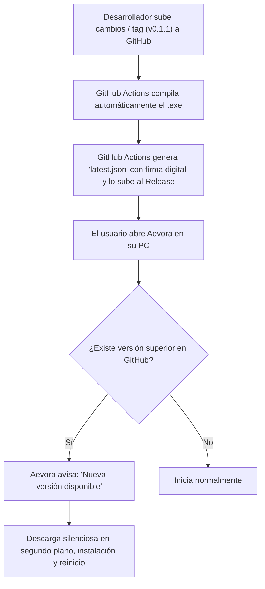

# Aevora Launcher

Aevora es un lanzador de videojuegos de escritorio (*game launcher*) unificado con enfoque *desktop-first*, diseño *Super Premium* y una arquitectura desacoplada y honesta. La interfaz está construida con React 18, TypeScript y Tailwind CSS sobre animaciones fluidas con Framer Motion; la capa nativa y segura corre sobre Tauri 2 y Rust. Sin un proveedor conectado (actualmente Steam), la biblioteca se mantiene vacía de forma transparente en lugar de mostrar juegos ficticios.

---

## 🚀 Descarga y Ejecutables (Windows 64-bit)

Los binarios de producción de la versión **v0.1.0** listos para usar se encuentran generados en:

* **Instalador recomendado (NSIS .exe con asistente):**
  [`src-tauri/target/release/bundle/nsis/Aevora_0.1.0_x64-setup.exe`](file:///c:/Users/Andreh/Desktop/new%20launcher/src-tauri/target/release/bundle/nsis/Aevora_0.1.0_x64-setup.exe) *(~2.89 MB)*
* **Paquete Windows Installer (.msi):**
  [`src-tauri/target/release/bundle/msi/Aevora_0.1.0_x64_en-US.msi`](file:///c:/Users/Andreh/Desktop/new%20launcher/src-tauri/target/release/bundle/msi/Aevora_0.1.0_x64_en-US.msi) *(~4.14 MB)*
* **Ejecutable Portable Standalone (.exe):**
  [`src-tauri/target/release/aevora.exe`](file:///c:/Users/Andreh/Desktop/new%20launcher/src-tauri/target/release/aevora.exe) *(~12.1 MB)*

> [!TIP]
> Puedes copiar el instalador o el ejecutable a cualquier carpeta o distribuirlo directamente. Para publicar una nueva versión para tus usuarios, puedes subir estos archivos a la pestaña **Releases** de tu repositorio en GitHub.

---

## 🔄 ¿Cómo funciona la Auto-Actualización desde GitHub?

Sí, **se puede configurar para que cada vez que hagas un update en GitHub, la app detecte la nueva versión, la descargue y se actualice sola**.

Tauri 2 soporta esto de forma nativa a través del plugin oficial **Updater** y **GitHub Releases**:

### 1. El Flujo de Actualización Automática



### 2. Configuración en GitHub Actions (Ya incluida)

Se ha añadido el workflow listo para usar en [`.github/workflows/release.yml`](file:///.github/workflows/release.yml).

Cada vez que publiques una nueva versión:
```bash
git tag v0.1.1
git push origin v0.1.1
```
GitHub Actions automáticamente compilará el instalador para Windows, firmará el paquete y publicará el nuevo Release en GitHub adjuntando el instalador y el manifiesto `latest.json` para el auto-updater.

### 3. Activar el plugin de Auto-Update en la app

Para vincular tu repositorio específico de GitHub con el updater de Tauri:
1. Genera las claves criptográficas de actualización ejecutando una sola vez:
   ```bash
   npx @tauri-apps/cli signer generate -w ~/.tauri/aevora.key
   ```
2. Agrega la clave pública resultante en `src-tauri/tauri.conf.json`:
   ```json
   {
     "plugins": {
       "updater": {
         "endpoints": [
           "https://github.com/<TU_USUARIO>/<TU_REPOSITORIO>/releases/latest/download/latest.json"
         ],
         "pubkey": "<TU_CLAVE_PUBLICA_AQUI>"
       }
     }
   }
   ```
3. Agrega la clave privada en los **Secrets** de tu repositorio en GitHub como `TAURI_SIGNING_PRIVATE_KEY`.

---

## 💎 Características y Calidad Super Premium

* **Pipeline de Arte Multi-CDN en Ultra Alta Resolución**:
  * Resolución inteligente de carátulas 2x (`library_600x900_2x.jpg` a 1200×1800) y panorámicas HD (`library_hero.jpg` a 1920×620).
  * Redundancia entre Cloudflare CDN y Akamai CDN para eliminar fallos por saturación o caídas de red.
  * **Atmospheric Nebula Mesh Hero**: Si la red no estuviese disponible, la aplicación genera un fondo ambiental procedimental con resplandor en lugar de cajas negras o imágenes rotas.
* **Diseño Glassmorphism y Profundidad**:
  * Marcos multicapa con reflejos especulares de luz superior.
  * Animaciones de física natural orgánica (`cubic-bezier(0.16, 1, 0.3, 1)`) que eliminan la rigidez.
  * Tarjetas de juego con indicador activo de instalación (*emerald spark*) y halo luminoso reactivo.
* **Seguridad Absoluta de Credenciales**:
  * La API key de Steam nunca se almacena en el navegador ni en variables web; se guarda de forma nativa en el **Administrador de Credenciales de Windows** (*Windows Credential Manager*).
* **Lanzamiento Nativo Directo**:
  * Lanzamiento de juegos mediante protocolo seguro `steam://rungameid/<appid>`.

---

## 🛠️ Requisitos de Desarrollo en Windows

* Node.js LTS (v18+) y npm
* Git
* Microsoft C++ Build Tools (con SDK de Windows y MSVC)
* Microsoft Edge WebView2 Runtime
* Rust (`stable-x86_64-pc-windows-msvc`)

---

## 💻 Comandos de Desarrollo

Instalar dependencias:
```bash
npm install
```

Iniciar entorno de desarrollo web en navegador:
```bash
npm run dev
```

Iniciar entorno de desarrollo nativo de escritorio (Tauri):
```bash
npm run tauri:dev
```

Ejecutar suite de pruebas (Vitest):
```bash
npm test
```

Verificación completa (TypeScript + Tests + Build):
```bash
npm run check
```

Compilar instalador y ejecutables de producción:
```bash
npm run tauri:build
```

---

## 📂 Mapa del Proyecto

```text
src/domain/                  Modelos canónicos de juegos, perfil y almacenamiento
src/integrations/cache/     Almacén de caché con expiración TTL y control de estado obsoleto
src/integrations/steam/     Normalizador y adaptador de APIs públicas de Steam
src/integrations/desktop/   Puente tipado y seguro con comandos de Tauri
src/components/             Componentes UI: HeroBanner, GameCard, GameDetails, Sidebar, etc.
src/views/                  Vistas principales: Biblioteca, Tienda Steam, Comunidad y Perfil
src-tauri/                  Backend nativo en Rust: comandos de lanzamiento y Windows Credential Manager
tests/                      Pruebas unitarias de dominio, integración y accesibilidad
.github/workflows/          Automatización de releases y auto-actualizaciones con GitHub Actions
```
